# Diagramas y modelado de RunTrash

Documentación visual del sistema real. Los diagramas se derivaron de
`servidor/server.js`, `servidor/routes/`, `servidor/services/`,
`servidor/repositories/`, `servidor/migrations/` y `frontend/`.

> **Fecha de corte:** 11 de noviembre de 2026.
> **Convención:** los nombres de tablas, rutas, roles y archivos coinciden
> con el código. Las decisiones que no están implementadas se marcan como
> supuestos al final del documento.

## Índice

1. [Contexto del sistema (C4 nivel 1)](#1-contexto-del-sistema-c4-nivel-1)
2. [Contenedores y componentes (C4 nivel 2 y 3)](#2-contenedores-y-componentes-c4-nivel-2-y-3)
3. [Casos de uso por rol](#3-casos-de-uso-por-rol)
4. [Modelo de clases del dominio](#4-modelo-de-clases-del-dominio)
5. [Modelo entidad-relación de PostgreSQL](#5-modelo-entidad-relación-de-postgresql)
6. [Secuencias](#6-secuencias)
   - [6.1 Inicio de sesión](#61-inicio-de-sesión)
   - [6.2 Creación de un reporte](#62-creación-de-un-reporte)
   - [6.3 Asignación manual](#63-asignación-manual)
   - [6.4 Asignación automática](#64-asignación-automática)
   - [6.5 Cambio de estado](#65-cambio-de-estado)
   - [6.6 Notificaciones y SSE](#66-notificaciones-y-sse)
   - [6.7 Recuperación de contraseña](#67-recuperación-de-contraseña)
7. [Actividad del ciclo de vida del reporte](#7-actividad-del-ciclo-de-vida-del-reporte)
8. [Estados del reporte](#8-estados-del-reporte)
9. [Despliegue](#9-despliegue)
10. [Navegación del frontend y módulos compartidos](#10-navegación-del-frontend-y-módulos-compartidos)
11. [Trazabilidad código → diagrama](#11-trazabilidad-código-diagrama)
12. [Supuestos y límites](#12-supuestos-y-límites)

---

## 1. Contexto del sistema (C4 nivel 1)

RunTrash conecta a ciudadanos que reportan residuos con empresas y
operarios que los atienden. Los entes de control supervisan la operación
y el administrador mantiene usuarios, configuración y catálogos.

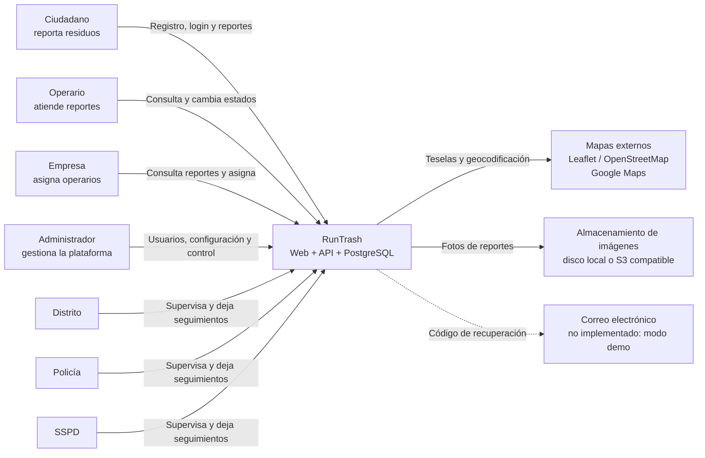

**Lectura del diagrama**

- El ciudadano solo ve sus propios reportes (`GET /api/reportes/usuario/:id`).
- El operario solo ve y actualiza los reportes que tiene asignados.
- La empresa consulta todos los reportes y asigna operarios de su empresa
  (el administrador comparte ese permiso).
- Distrito, Policía y SSPD comparten el panel `control.html` y los
  endpoints `/api/control/*`, pero cada ente solo ve sus propios
  seguimientos; el administrador ve el historial completo.
- Las imágenes se guardan en disco local o en un bucket S3 compatible.
- El envío real de correo no está implementado; en modo demo el código de
  recuperación se devuelve en la respuesta (`codigo_demo`).

---

## 2. Contenedores y componentes (C4 nivel 2 y 3)

### 2.1 Contenedores

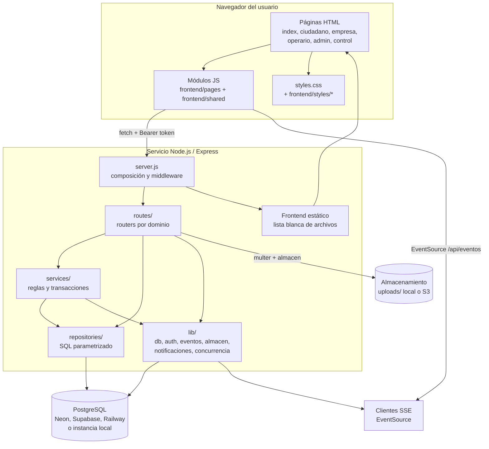

### 2.2 Componentes del backend

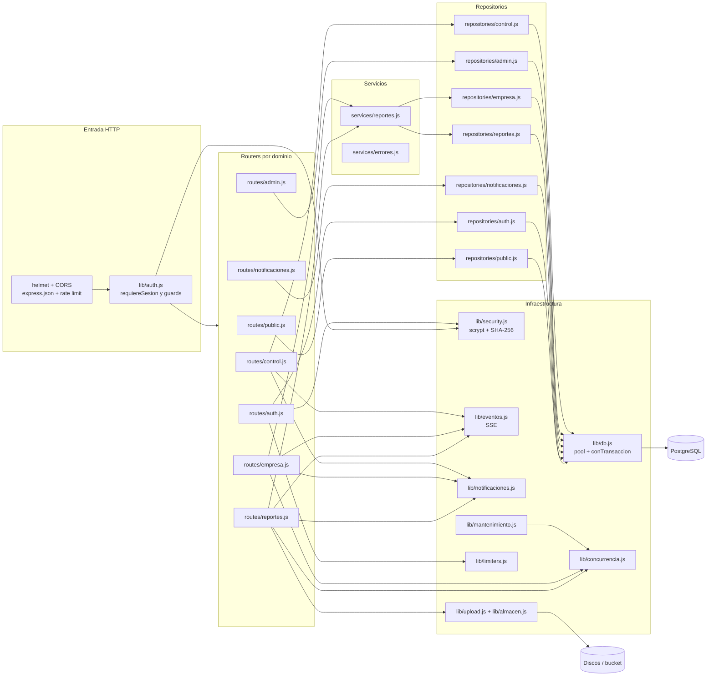

**Regla de capas**

1. `routes/` valida la petición, llama al servicio o repositorio y
   traduce el resultado a HTTP.
2. `services/` contiene las reglas que afectan a más de una fila y abre
   transacciones con `conTransaccion`.
3. `repositories/` es la única capa que ejecuta SQL.
4. `lib/` agrupa infraestructura reutilizable y no conoce Express salvo
   en los middleware de `auth.js`.

---

## 3. Casos de uso por rol

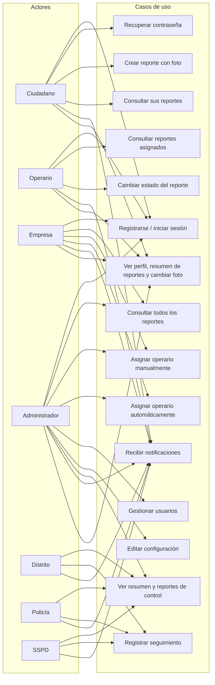

| Rol | Panel | Casos de uso principales | Guard del backend |
| --- | --- | --- | --- |
| `ciudadano` | `ciudadano.html` | Registro, login, crear reporte, consultar sus reportes, notificaciones, perfil | `requiereCiudadano` |
| `operario` | `operario.html` | Login, ver asignados, cambiar estado, notificaciones, perfil | `requiereOperario` |
| `empresa` | `empresa.html` | Login, ver reportes de su ámbito, asignar manual/automático, notificaciones, perfil | `requiereEmpresa` (`empresa` o `admin`) |
| `admin` | `admin.html` | Usuarios, configuración, resumen, asignaciones y control | `requiereAdmin` y `requiereEnteControl` |
| `distrito` | `control.html` | Resumen, reportes filtrados, detalle y seguimientos propios | `requiereEnteControl` |
| `policia` | `control.html` | Resumen, reportes filtrados, detalle y seguimientos propios | `requiereEnteControl` |
| `sspd` | `control.html` | Resumen, reportes filtrados, detalle y seguimientos propios | `requiereEnteControl` |

**Restricciones relevantes**

- El registro público solo acepta `ciudadano`; las cuentas de `empresa` y
  `operario` las crea un administrador (o la propia empresa para sus
  operarios).
- Solo el administrador puede crear cuentas `distrito`, `policia` y `sspd`.
- El login de operario exige su `codigo_operario` (últimos 4 dígitos del
  NIT de su empresa); el de empresa exige `nit_empresa`.
- Varios operarios de una empresa comparten código; un trigger de
  PostgreSQL rechaza cualquier código que no se derive del NIT.
- Tras cinco intentos fallidos la cuenta se bloquea 15 minutos.
- El operario no puede fijar el estado `pendiente`: solo `en proceso` o
  `completado`.
- Los entes de control no modifican el estado del reporte; dejan
  seguimientos trazables. Cada ente solo lee y cuenta sus propios
  seguimientos; el administrador conserva la vista global.

---

## 4. Modelo de clases del dominio

Vista conceptual. No todas las clases son tablas: `EventoSSE` y
`Almacen` representan infraestructura.

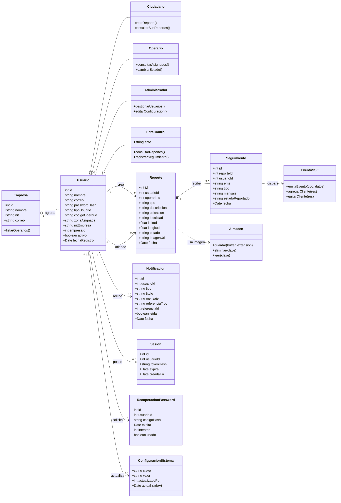

**Notas de modelado**

- `Empresa` es una tabla independiente y también un rol de acceso. Un
  usuario con `tipo_usuario = 'empresa'` se enlaza a `empresas` mediante
  `empresa_id` y conserva el NIT en `nit_empresa`.
- `Operario` y `Ciudadano` no tienen tablas propias: son filas de
  `usuarios` discriminadas por `tipo_usuario`.
- `EnteControl` agrupa los tres roles externos (`distrito`, `policia`,
  `sspd`) y también admite `admin` en los endpoints de consulta.
- `Reporte.operarioId` es opcional mientras el reporte está pendiente.
- `Seguimiento` es la trazabilidad de los entes de control y no cambia
  el estado del reporte.

---

## 5. Modelo entidad-relación de PostgreSQL

Diagrama basado en las migraciones `001`, `005` y `006`. Los tipos se
muestran simplificados para que Mermaid los renderice.

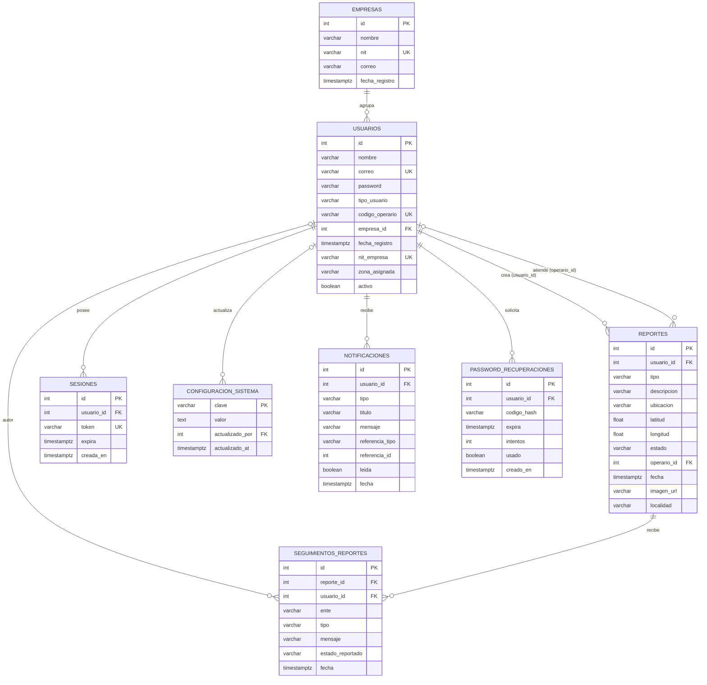

**Restricciones reales**

| Elemento | Regla |
| --- | --- |
| `usuarios.tipo_usuario` | `ciudadano`, `operario`, `empresa`, `admin`, `distrito`, `policia`, `sspd` |
| `reportes.estado` | `pendiente`, `en proceso`, `completado` |
| `seguimientos_reportes.ente` | `distrito`, `policia`, `sspd`, `admin` |
| `seguimientos_reportes.tipo` | `observacion`, `requerimiento`, `visita`, `cierre` |
| `empresas.nit` | único |
| `usuarios.correo` | único por `LOWER(correo)` |
| `usuarios.codigo_operario` | único cuando no es nulo ni vacío |
| `usuarios.nit_empresa` | único cuando no es nulo ni vacío |
| `reportes.usuario_id` | `ON DELETE RESTRICT` |
| `reportes.operario_id` | `ON DELETE SET NULL` |
| `notificaciones.usuario_id` | `ON DELETE CASCADE` |
| `password_recuperaciones.usuario_id` | `ON DELETE CASCADE` |
| `seguimientos_reportes.reporte_id` | `ON DELETE CASCADE` |
| `seguimientos_reportes.usuario_id` | `ON DELETE SET NULL` |

**Datos iniciales de `configuracion_sistema`**

| Clave | Valor por defecto | Rango editable desde admin |
| --- | --- | --- |
| `limite_reportes_diarios` | `5` | 1–20 |
| `limite_ruta` | `15` | 1–50 |
| `retencion_dias` | `90` | 1–365 |
| `distancia_gps_maxima` | `20` | 5–100 |

---

## 6. Secuencias

### 6.1 Inicio de sesión

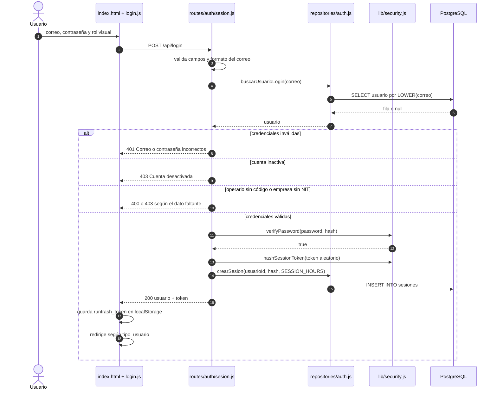

**Destino por rol**

| `tipo_usuario` | Página |
| --- | --- |
| `ciudadano` | `ciudadano.html` |
| `operario` | `operario.html` |
| `empresa` | `empresa.html` |
| `admin` | `admin.html` |
| `distrito`, `policia`, `sspd` | `control.html` |

> El rol `admin` no aparece en el selector del login público. Su acceso
> es directo por `admin.html`, que tiene su propia pantalla de ingreso y
> valida que la cuenta sea de tipo administrador.

### 6.2 Creación de un reporte

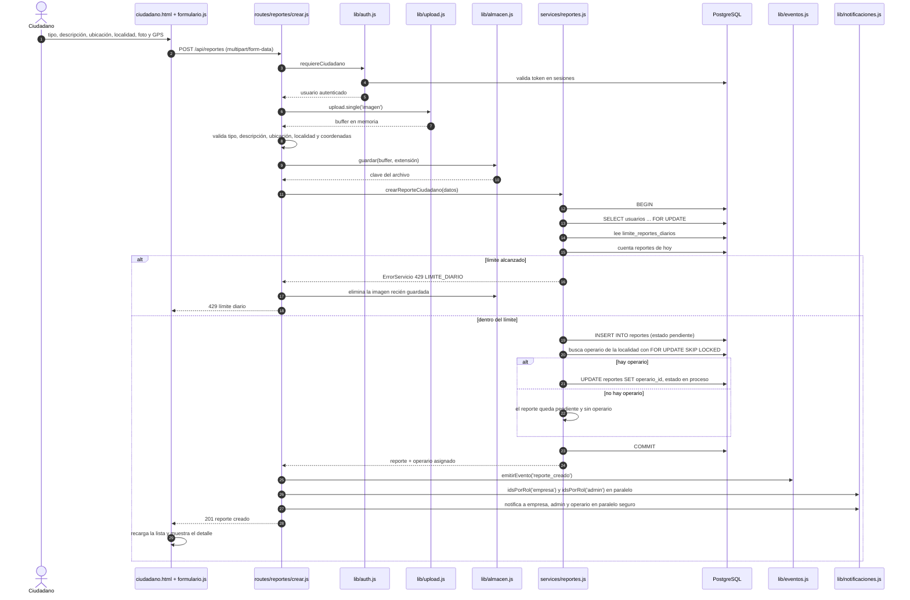

**Puntos de concurrencia**

- `FOR UPDATE` sobre `usuarios` serializa los envíos del mismo ciudadano.
- La comprobación del límite y el `INSERT` comparten transacción.
- `FOR UPDATE SKIP LOCKED` evita que dos reportes simultáneos elijan al
  mismo operario.
- Si el `INSERT` o una regla posterior fallan, la imagen se elimina para
  no dejar archivos huérfanos.

### 6.3 Asignación manual

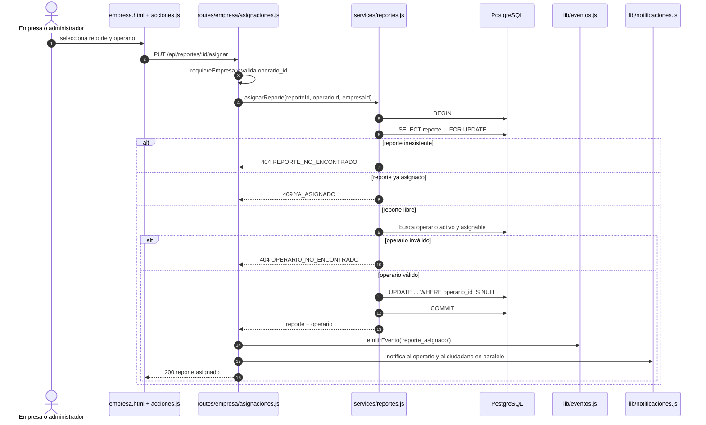

### 6.4 Asignación automática

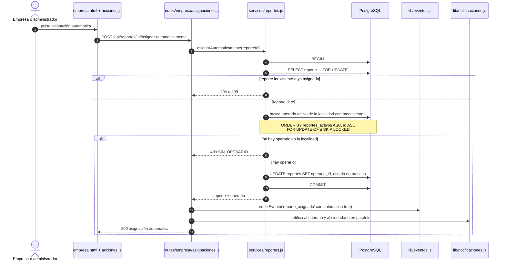

### 6.5 Cambio de estado

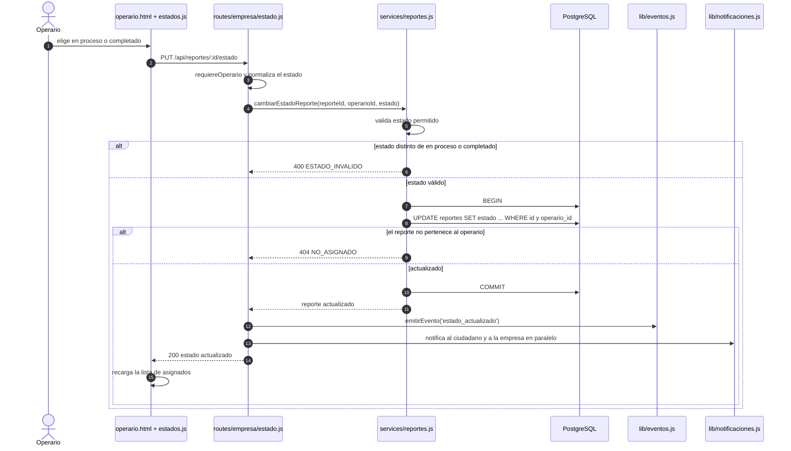

### 6.6 Notificaciones y SSE

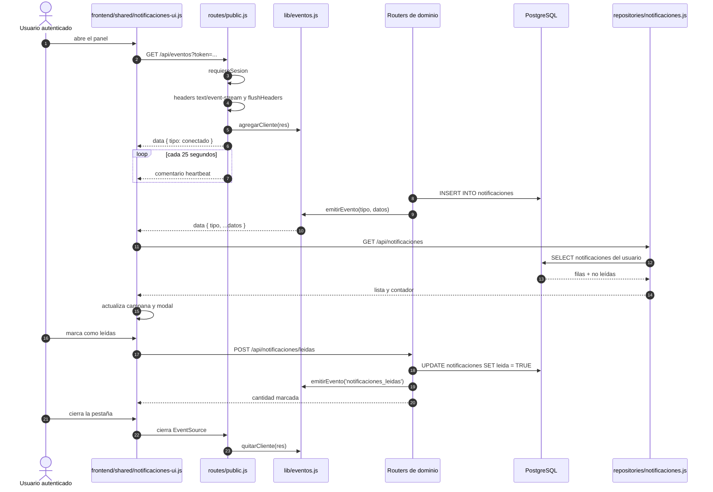

**Eventos emitidos por el backend**

| Evento | Origen | Uso en el frontend |
| --- | --- | --- |
| `reporte_creado` | `routes/reportes/crear.js` | Refrescar listas de empresa, admin y control |
| `reporte_asignado` | `routes/empresa/asignaciones.js` | Refrescar operario y empresa |
| `estado_actualizado` | `routes/empresa/estado.js` | Refrescar ciudadano, empresa y control |
| `seguimiento_creado` | `routes/control.js` | Refrescar detalle de control |
| `notificaciones_leidas` | `routes/notificaciones.js` | Actualizar contador de la campana |
| `usuario_creado` / `usuario_actualizado` | `routes/admin/usuarios.js` | Refrescar panel admin |
| `configuracion_actualizada` | `routes/admin/configuracion.js` | Refrescar configuración |
| `password_restablecida` | `routes/auth/password.js` | Invalidar sesiones y avisar |

### 6.7 Recuperación de contraseña

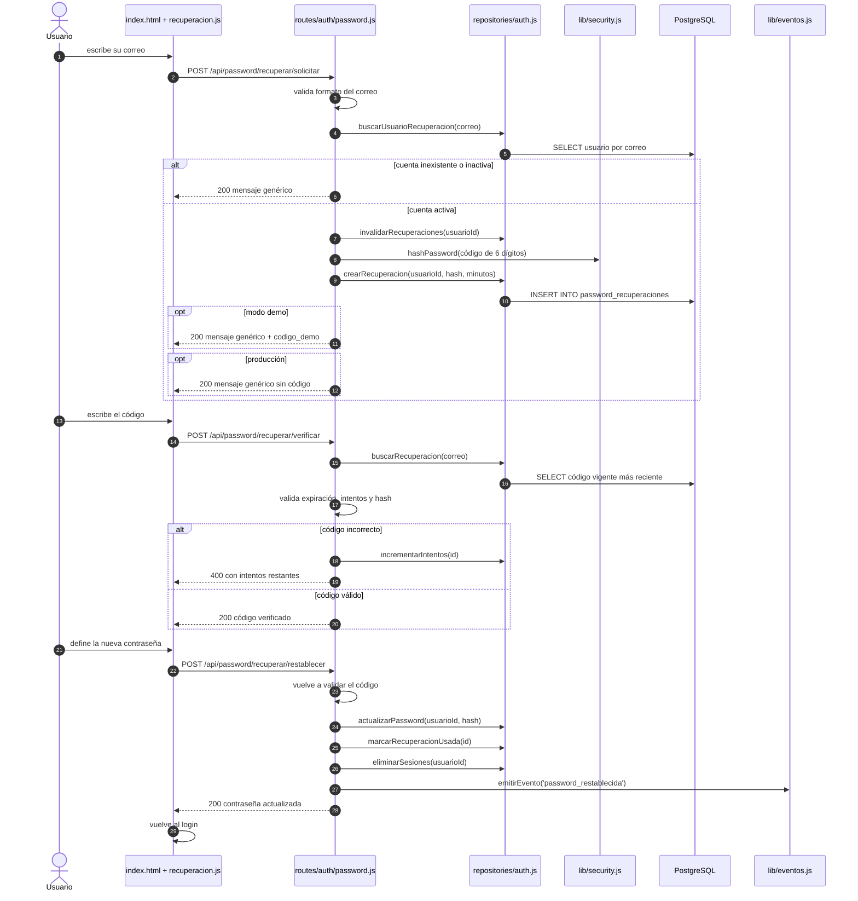

**Límites del flujo**

- Código de 6 dígitos, vigencia por defecto de 20 minutos y máximo de 5
  intentos (`RECUPERACION_MINUTOS`, `RECUPERACION_INTENTOS`).
- La respuesta de solicitud es genérica para no revelar si el correo
  existe.
- En modo demo el código se muestra en pantalla; en producción se
  enviaría por correo, pero el envío real no está implementado.
- Al restablecer se eliminan todas las sesiones del usuario.

### 6.8 Ingreso con Google u Outlook (OAuth 2.0 + PKCE)

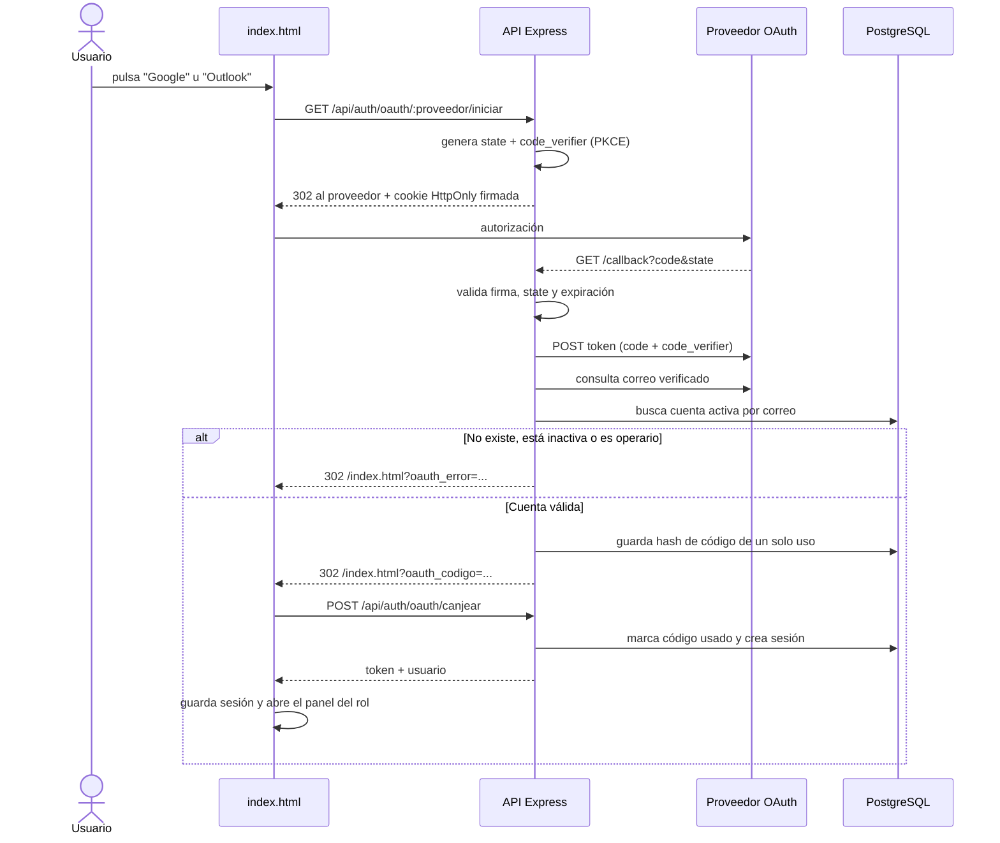

**Límites del flujo**

- El token de sesión nunca viaja en la URL; solo el código de un solo uso,
  con vigencia de 2 minutos.
- El `state` y el `code_verifier` viven en una cookie HttpOnly de 10
  minutos; el callback los borra.
- No se crean cuentas: el correo debe existir previamente en RunTrash.
- Los operarios quedan fuera de OAuth y siguen usando sus dos códigos.

---

## 7. Actividad del ciclo de vida del reporte

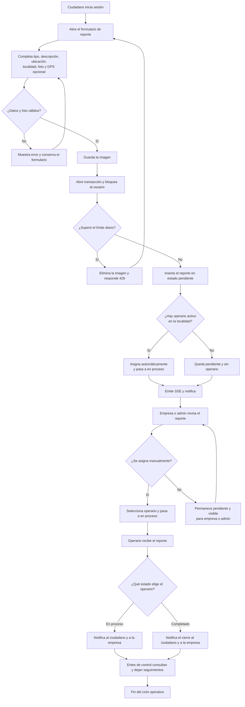

**Reglas del flujo**

1. El reporte nace siempre en `pendiente`.
2. La asignación automática ocurre dentro de la misma transacción de
   creación.
3. Si no hay operario en la localidad, el reporte queda visible para que
   la empresa lo asigne manualmente.
4. La asignación manual y la automática compiten con `FOR UPDATE` y
   `SKIP LOCKED`, por lo que un reporte no puede quedar con dos operarios.
5. El operario puede alternar entre `en proceso` y `completado`; no puede
   volver a `pendiente` desde el endpoint de estado.
6. Los seguimientos de control son posteriores y no alteran el estado.

---

## 8. Estados del reporte

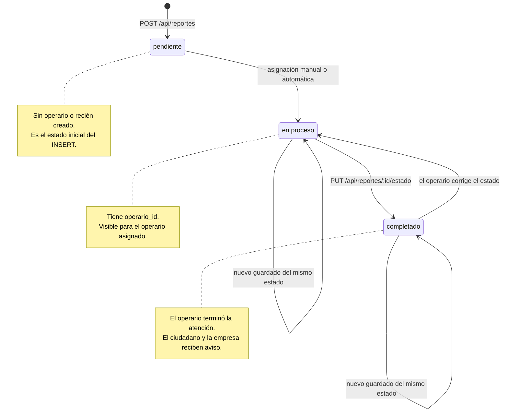

**Transiciones permitidas**

| Desde | Hacia | Quién | Endpoint |
| --- | --- | --- | --- |
| — | `pendiente` | Ciudadano | `POST /api/reportes` |
| `pendiente` | `en proceso` | Empresa o admin | `PUT /api/reportes/:id/asignar` |
| `pendiente` | `en proceso` | Empresa o admin | `POST /api/reportes/:id/asignar-automaticamente` |
| `pendiente` | `en proceso` | Servicio de creación | Asignación automática interna |
| `en proceso` | `completado` | Operario asignado | `PUT /api/reportes/:id/estado` |
| `completado` | `en proceso` | Operario asignado | `PUT /api/reportes/:id/estado` |
| `en proceso` | `en proceso` | Operario asignado | `PUT /api/reportes/:id/estado` |

No existe una transición a `pendiente` desde el endpoint de estado.

### 8.1 Estados de una cuenta y de una recuperación

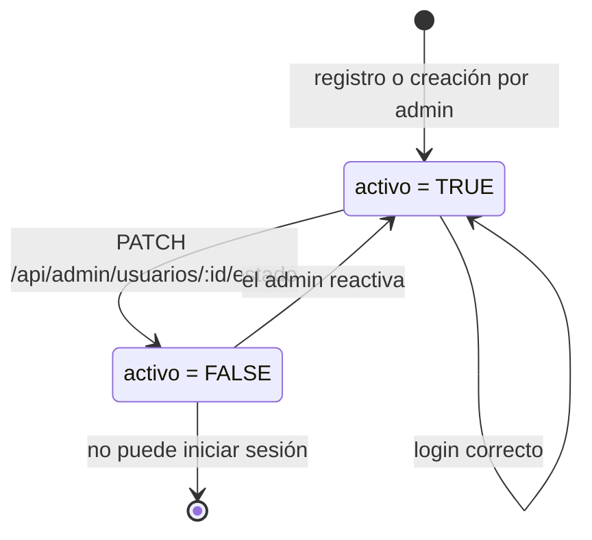

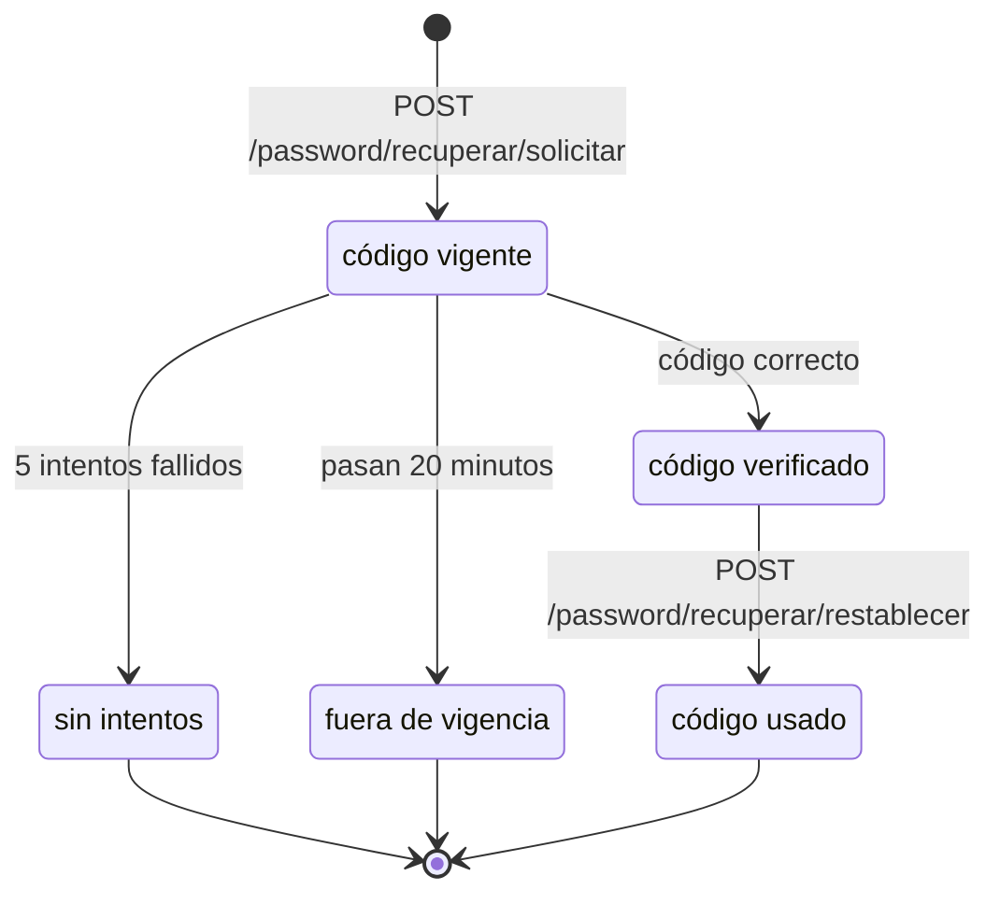

---

## 9. Despliegue

### 9.1 Despliegue local

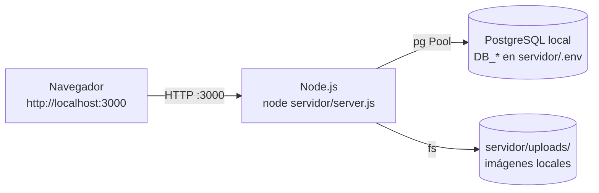

### 9.2 Despliegue en Render + Neon

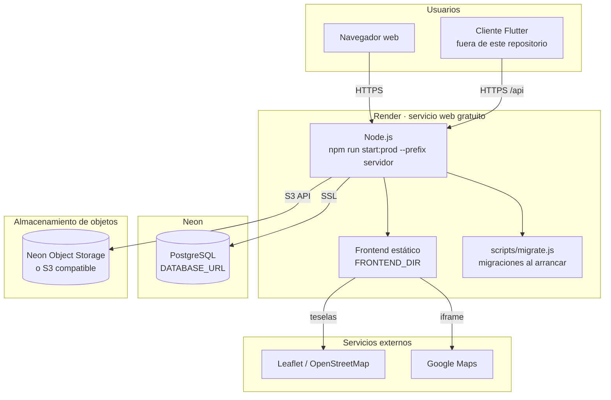

**Variables de entorno relevantes**

| Variable | Uso |
| --- | --- |
| `DATABASE_URL` | Conexión PostgreSQL remota; tiene prioridad sobre `DB_*` |
| `DB_HOST`, `DB_PORT`, `DB_NAME`, `DB_USER`, `DB_PASSWORD` | Conexión local |
| `DB_SSL` | Fuerza SSL en conexiones `DB_*` |
| `PORT` | Puerto HTTP, por defecto `3000` |
| `FRONTEND_DIR` | Carpeta de HTML que sirve Express |
| `CORS_ORIGINS` | Orígenes permitidos, separados por coma |
| `TRUST_PROXY` | Confianza en el proxy de Render |
| `SESSION_HOURS` | Vigencia de sesiones |
| `MAX_UPLOAD_MB` | Tamaño máximo de imagen |
| `ADMIN_NAME`, `ADMIN_EMAIL`, `ADMIN_PASSWORD` | Cuenta administradora inicial |
| `STORAGE_PROVIDER`, `STORAGE_S3_*` | Almacenamiento local o S3 |
| `EXPOSER_CODIGO_RECUPERACION` | Muestra el código en modo demo |
| `RECUPERACION_MINUTOS`, `RECUPERACION_INTENTOS` | Vigencia e intentos del código |
| `DIAGNOSTICO_DETALLE` | Expone detalle técnico en errores 500 |

**Consideraciones**

- `render.yaml` usa `rootDir: .`, `buildCommand` con `--prefix servidor`
  y `startCommand` con `start:prod`.
- Las migraciones se ejecutan antes de `server.js` en `start:prod`.
- El disco de Render es efímero; para producción se recomienda S3.
- La CSP permite Leaflet y Google Maps, pero no scripts inline.

---

## 10. Navegación del frontend y módulos compartidos

### 10.1 Mapa de páginas

```mermaid
flowchart TB
    INICIO["index.html<br/>login, registro y recuperación"]
    CIU["ciudadano.html"]
    EMP["empresa.html"]
    OPE["operario.html"]
    ADM["admin.html"]
    CTR["control.html"]

    INICIO -->|"ciudadano"| CIU
    INICIO -->|"empresa"| EMP
    INICIO -->|"operario"| OPE
    INICIO -->|"admin"| ADM
    INICIO -->|"distrito / policia / sspd"| CTR

    CIU -->|"crear reporte"| CIU
    EMP -->|"asignar"| EMP
    OPE -->|"cambiar estado"| OPE
    ADM -->|"usuarios y configuración"| ADM
    CTR -->|"seguimientos"| CTR
```

### 10.2 Dependencias de scripts

```mermaid
flowchart LR
    subgraph Base["Base común"]
        CFG["config.js"]
        API["frontend/shared/api.js"]
        UI["ui.js"]
        FEAT["features.js"]
        COMMON["frontend/shared/ui-common.js"]
        CONC["frontend/shared/concurrencia.js"]
        PERFIL["frontend/shared/perfil.js"]
        NOTI["frontend/shared/notificaciones-ui.js"]
    end

    subgraph Inicio["frontend/pages/inicio"]
        I_EST["estado.js"]
        I_LOG["login.js"]
        I_REG["registro.js"]
        I_REC["recuperacion.js"]
        I_INIT["init.js"]
    end

    subgraph Ciudadano["frontend/pages/ciudadano"]
        C_EST["estado.js"]
        C_UTIL["utils.js"]
        C_DAT["datos.js"]
        C_REN["render.js"]
        C_FORM["formulario.js"]
        C_DET["detalle.js"]
        C_NOT["notificaciones.js"]
        C_PER["perfil.js"]
        C_NAV["navegacion.js"]
        C_INIT["init.js"]
    end

    subgraph Empresa["frontend/pages/empresa"]
        E_EST["estado.js"]
        E_DAT["datos.js"]
        E_MAP["mapa.js"]
        E_REN["render.js"]
        E_ACC["acciones.js"]
        E_NOT["notificaciones.js"]
        E_PER["perfil.js"]
        E_INIT["init.js"]
    end

    subgraph Operario["frontend/pages/operario"]
        O_EST["estado.js"]
        O_UTIL["utils.js"]
        O_DAT["datos.js"]
        O_REN["render.js"]
        O_DET["detalle.js"]
        O_EDO["estados.js"]
        O_RUT["rutas.js"]
        O_NOT["notificaciones.js"]
        O_PER["perfil.js"]
        O_NAV["navegacion.js"]
        O_INIT["init.js"]
    end

    subgraph Admin["frontend/pages/admin"]
        A_EST["estado.js"]
        A_DAT["datos.js"]
        A_NOT["notificaciones.js"]
        A_EV["eventos.js"]
        A_SES["sesion.js"]
        A_REN["render.js"]
        A_USU["usuarios.js"]
        A_CFG["configuracion.js"]
        A_DET["detalle.js"]
        A_PER["perfil.js"]
        A_NAV["navegacion.js"]
        A_INIT["init.js"]
    end

    subgraph Control["frontend/pages/control"]
        K_EST["estado.js"]
        K_NAV["navegacion.js"]
        K_PER["perfil.js"]
        K_NOT["notificaciones.js"]
        K_LOC["localidades.js"]
        K_DAT["datos.js"]
        K_REN["render.js"]
        K_DET["detalle.js"]
        K_SEG["seguimiento.js"]
        K_EXP["exportar.js"]
        K_RT["realtime.js"]
        K_INIT["init.js"]
    end

    CFG --> API
    API --> COMMON
    COMMON --> CONC
    COMMON --> PERFIL
    COMMON --> NOTI
    UI --> COMMON
    FEAT --> COMMON

    INICIO --> I_INIT
    CIU --> C_INIT
    EMP --> E_INIT
    OPE --> O_INIT
    ADM --> A_INIT
    CTR --> K_INIT

    I_INIT --> I_LOG
    I_INIT --> I_REG
    I_INIT --> I_REC
    C_INIT --> C_DAT
    C_INIT --> C_REN
    C_INIT --> C_FORM
    C_INIT --> C_DET
    C_INIT --> C_NAV
    E_INIT --> E_DAT
    E_INIT --> E_MAP
    E_INIT --> E_REN
    E_INIT --> E_ACC
    O_INIT --> O_DAT
    O_INIT --> O_REN
    O_INIT --> O_EDO
    O_INIT --> O_RUT
    A_INIT --> A_DAT
    A_INIT --> A_USU
    A_INIT --> A_CFG
    A_INIT --> A_DET
    K_INIT --> K_DAT
    K_INIT --> K_REN
    K_INIT --> K_DET
    K_INIT --> K_SEG
    K_INIT --> K_EXP
    K_INIT --> K_RT
```

**Orden real de carga**

1. `config.js` define opcionalmente `window.RUNTRASH_API`.
2. `frontend/shared/api.js` calcula la base, el token y `request()`.
3. `ui.js` y `features.js` preparan navegación y utilidades globales.
4. `frontend/shared/ui-common.js` registra el despachador de
   `data-accion`, los toasts y la campana.
5. `frontend/shared/concurrencia.js` añade deduplicación, cancelación y
   sondeos.
6. `frontend/shared/perfil.js` monta la tarjeta, el resumen de reportes
   por estado y la foto editable; `notificaciones-ui.js` monta el modal
   de notificaciones.
7. Los módulos de la página se ejecutan en el orden declarado y
   `init.js` arranca la carga inicial.

### 10.3 Flujo de una acción de interfaz

```mermaid
sequenceDiagram
    autonumber
    actor U as Usuario
    participant DOM as Botón con data-accion
    participant COM as frontend/shared/ui-common.js
    participant FN as Función global de la página
    participant API as frontend/shared/api.js
    participant SRV as API Express

    U->>DOM: clic, cambio o submit
    DOM->>COM: evento delegado
    COM->>COM: lee data-accion, data-args y data-pasar
    COM->>FN: ejecuta window[accion](...)
    FN->>API: request(ruta, opciones)
    API->>API: añade Authorization: Bearer token
    API->>SRV: fetch
    SRV-->>API: JSON
    API-->>FN: Response
    FN->>DOM: actualiza la vista o muestra un toast
```

---

## 11. Trazabilidad código → diagrama

| Diagrama | Archivos principales |
| --- | --- |
| Contexto | `README.md`, `docs/ARQUITECTURA.md`, `render.yaml` |
| Contenedores | `servidor/server.js`, `servidor/config.js`, `frontend/shared/api.js` |
| Componentes backend | `servidor/routes/*.js`, `servidor/services/*.js`, `servidor/repositories/*.js`, `servidor/lib/*.js` |
| Casos de uso | `servidor/lib/auth.js`, `frontend/pages/*/navegacion.js`, rutas por dominio |
| Clases | `servidor/migrations/001_postgres_schema.sql`, `005_notificaciones_recuperacion.sql`, `006_roles_control.sql`, `services/reportes.js` |
| ER | Migraciones `001`, `005` y `006` |
| Login | `routes/auth/sesion.js`, `repositories/auth.js`, `lib/security.js`, `frontend/pages/inicio/login.js` |
| Crear reporte | `routes/reportes/crear.js`, `services/reportes.js`, `repositories/reportes.js`, `lib/upload.js`, `lib/almacen.js` |
| Asignación manual | `routes/empresa/asignaciones.js`, `services/reportes.js`, `repositories/empresa.js` |
| Asignación automática | `routes/empresa/asignaciones.js`, `services/reportes.js`, `repositories/empresa.js` |
| Cambio de estado | `routes/empresa/estado.js`, `services/reportes.js`, `repositories/empresa.js` |
| SSE y notificaciones | `routes/public.js`, `lib/eventos.js`, `lib/notificaciones.js`, `repositories/notificaciones.js`, `frontend/shared/notificaciones-ui.js` |
| Recuperación | `routes/auth/password.js`, `repositories/auth.js`, `frontend/pages/inicio/recuperacion.js` |
| Actividad y estados | `services/reportes.js`, `repositories/reportes.js`, `repositories/empresa.js`, migración `001` |
| Despliegue | `render.yaml`, `DEPLOY.md`, `servidor/config.js`, `servidor/lib/db.js`, `servidor/lib/almacen.js` |
| Frontend | `index.html`, `ciudadano.html`, `empresa.html`, `operario.html`, `admin.html`, `control.html`, `frontend/pages/`, `frontend/shared/` |

### 11.1 Endpoints usados en los diagramas

| Método | Ruta | Guard | Archivo |
| --- | --- | --- | --- |
| `GET` | `/api/prueba` | Público | `routes/public.js` |
| `GET` | `/api/eventos` | `requiereSesion` | `routes/public.js` |
| `GET` | `/api/configuracion/publica` | Público | `routes/public.js` |
| `POST` | `/api/registro` | Público + `authLimiter` | `routes/auth/registro.js` |
| `POST` | `/api/login` | Público + `authLimiter` | `routes/auth/sesion.js` |
| `GET` | `/api/me` | `requiereSesion` | `routes/auth/sesion.js` |
| `POST` | `/api/logout` | Público | `routes/auth/sesion.js` |
| `POST` | `/api/password/cambiar` | `requiereSesion` | `routes/auth/password.js` |
| `POST` | `/api/password/recuperar/solicitar` | Público + `authLimiter` | `routes/auth/password.js` |
| `POST` | `/api/password/recuperar/verificar` | Público + `authLimiter` | `routes/auth/password.js` |
| `POST` | `/api/password/recuperar/restablecer` | Público + `authLimiter` | `routes/auth/password.js` |
| `POST` | `/api/reportes` | `requiereCiudadano` | `routes/reportes/crear.js` |
| `GET` | `/api/reportes/usuario/:usuarioId` | `requiereCiudadano` | `routes/reportes/consultas.js` |
| `GET` | `/api/reportes/operario/:operarioId` | `requiereOperario` | `routes/reportes/consultas.js` |
| `GET` | `/api/reportes` | `requiereEmpresa` | `routes/reportes/consultas.js` |
| `GET` | `/api/operarios` | `requiereEmpresa` | `routes/empresa/operarios.js` |
| `PUT` | `/api/reportes/:id/asignar` | `requiereEmpresa` | `routes/empresa/asignaciones.js` |
| `POST` | `/api/reportes/:id/asignar-automaticamente` | `requiereEmpresa` | `routes/empresa/asignaciones.js` |
| `PUT` | `/api/reportes/:id/estado` | `requiereOperario` | `routes/empresa/estado.js` |
| `GET` | `/api/admin/resumen` | `requiereAdmin` | `routes/admin/resumen.js` |
| `GET` | `/api/admin/usuarios` | `requiereAdmin` | `routes/admin/usuarios.js` |
| `POST` | `/api/admin/usuarios` | `requiereAdmin` | `routes/admin/usuarios.js` |
| `PUT` | `/api/admin/usuarios/:id` | `requiereAdmin` | `routes/admin/usuarios.js` |
| `PUT` | `/api/admin/usuarios/:id/password` | `requiereAdmin` | `routes/admin/usuarios.js` |
| `PATCH` | `/api/admin/usuarios/:id/estado` | `requiereAdmin` | `routes/admin/usuarios.js` |
| `GET` | `/api/admin/configuracion` | `requiereAdmin` | `routes/admin/configuracion.js` |
| `PUT` | `/api/admin/configuracion` | `requiereAdmin` | `routes/admin/configuracion.js` |
| `GET` | `/api/perfil/resumen` | `requiereSesion` | `routes/perfil.js` |
| `PUT` | `/api/perfil/avatar` | `requiereSesion` | `routes/perfil.js` |
| `GET` | `/api/control/resumen` | `requiereEnteControl` | `routes/control.js` |
| `GET` | `/api/control/reportes` | `requiereEnteControl` | `routes/control.js` |
| `GET` | `/api/control/reportes/:id` | `requiereEnteControl` | `routes/control.js` |
| `POST` | `/api/control/reportes/:id/seguimiento` | `requiereEnteControl` | `routes/control.js` |
| `GET` | `/api/notificaciones` | `requiereSesion` | `routes/notificaciones.js` |
| `POST` | `/api/notificaciones/leidas` | `requiereSesion` | `routes/notificaciones.js` |

---

## 12. Supuestos y límites

1. **Diagramas basados en el código actual.** Si una ruta o tabla cambia,
   el diagrama debe actualizarse en el mismo cambio.
2. **Flutter no está en este repositorio.** El contexto lo menciona como
   cliente externo de la misma API, pero no se modelan sus pantallas.
3. **Correo real no implementado.** La recuperación usa `codigo_demo`
   solo cuando `EXPOSER_CODIGO_RECUPERACION=true` de forma explícita.
   En producción el valor por defecto es `false`, de modo que el código
   no se devuelve ni se escribe en los logs. El envío por correo queda
   como integración pendiente.
4. **Almacenamiento de imágenes.** En local se usa `servidor/uploads/`;
   en producción se recomienda S3 compatible porque el disco de Render es
   efímero. El diagrama muestra ambos modos. La ruta `/uploads/*` exige
   sesión y autorización por propietario, operario asignado o rol global;
   no es una carpeta estática.
5. **Rate limiting.** Se aplica a `/api` en general y un límite más
   estricto a login, registro y recuperación. No se modela el detalle de
   cada ventana porque depende de `lib/limiters.js`.
6. **Roles.** `admin` puede usar los endpoints de empresa y de control;
   los entes externos no pueden asignar ni cambiar estados.
7. **Estado `pendiente`.** Solo se asigna al crear el reporte o queda
   como estado inicial. No existe endpoint para volver a `pendiente`.
8. **Seguimientos.** Son observaciones de control; no reemplazan el
   estado operativo del reporte.
9. **Borrado de reportes.** `lib/mantenimiento.js` purga reportes
   retirados según `retencion_dias`; el diagrama de estados no incluye
   ese proceso porque no es un estado de negocio.
10. **Concurrencia.** Los diagramas muestran los bloqueos `FOR UPDATE` y
    `FOR UPDATE SKIP LOCKED`; el detalle de aislamiento depende de la
    configuración de PostgreSQL (por defecto `READ COMMITTED`).
